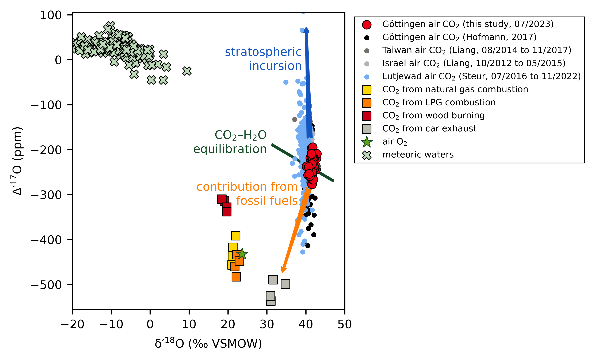

# Supplementary material for: Primary Productivity Resolved by Interhemispheric Measurements of Triple Oxygen Isotopes in Atmospheric CO2

## Graphical abstract

## Reference

> [!IMPORTANT]
> Ghoshmaulik et al. Primary Productivity Resolved by Interhemispheric Measurements of Triple Oxygen Isotopes in Atmospheric CO2. Under review.

## Codes

- [scale_goettingen_data.py](codes/scale_goettingen_data.py) scales the Göttingen CO2 triple oxygen isotope measurements using reference gases and provides results with and without a correction for sample–reference mixing-ratio differences. Input: [goettingen_2023_data_raw.csv](data/input/goettingen_2023_data_raw.csv). Output: [goettingen_2023_data_scaled.csv](data/output/goettingen_2023_data_scaled.csv), [goettingen_2023_data_scaled.xlsx](data/output/goettingen_2023_data_scaled.xlsx), [replicates.png](figures/png/replicates.png), and [replicates_corrected.png](figures/png/replicates_corrected.png).

- [plot_goettingen_data.py](codes/plot_goettingen_data.py) plots the Göttingen measurements through time. Input: [goettingen_2023_data_scaled.csv](data/output/goettingen_2023_data_scaled.csv). Output: [goettingen_2023_data_scaled_corrected.png](figures/png/goettingen_2023_data_scaled_corrected.png).

- [hourly_measurements.py](codes/hourly_measurements.py) compares the July 2023 Göttingen air measurements with temperature and a seasonal isotope model. Input: [goettingen_2023_data_scaled.csv](data/output/goettingen_2023_data_scaled.csv), [Hofmann2017_model.csv](data/input/Hofmann2017_model.csv), and hourly weather data retrieved from Meteostat. Output: [hourly_measurements_Dp17O_scaled_corrected.png](figures/png/hourly_measurements_Dp17O_scaled_corrected.png).

- [CO2_trends.py](codes/CO2_trends.py) compares the Göttingen air measurements with published CO2 and meteoric-water isotope data. Input: [goettingen_2023_data_raw.csv](data/input/goettingen_2023_data_raw.csv), [Liang2023.csv](data/input/Liang2023.csv), [Hofmann2017_data.csv](data/input/Hofmann2017_data.csv), [Boering2004.csv](data/input/Boering2004.csv), [Steur2024.csv](data/input/Steur2024.csv), [Horvath2012.csv](data/input/Horvath2012.csv), and [meteoric_water.csv](data/input/meteoric_water.csv). Output: [CO2_trends.png](figures/png/CO2_trends.png).

- [_helper_functions.py](codes/_helper_functions.py) provides shared isotope calculations and table export functions. Input: values and tables supplied by the analysis scripts. Output: calculated values and, when called by [scale_goettingen_data.py](codes/scale_goettingen_data.py), [goettingen_2023_data_scaled.csv](data/output/goettingen_2023_data_scaled.csv) and [goettingen_2023_data_scaled.xlsx](data/output/goettingen_2023_data_scaled.xlsx).

- [_plot_style.py](codes/_plot_style.py) provides the shared figure styling, colors, legends, and figure export functions. Input: figures supplied by the plotting scripts. Output: the figure files listed above.

All figures are also available as [SVG versions](figures/svg/).

## Data files

### Input data files

- [goettingen_2023_data_raw.csv](data/input/goettingen_2023_data_raw.csv) contains the raw Göttingen air and reference-gas replicate measurements and the corresponding analytical parameters. It is used by [scale_goettingen_data.py](codes/scale_goettingen_data.py) and [CO2_trends.py](codes/CO2_trends.py).

### Exported data files

- [goettingen_2023_data_scaled.csv](data/output/goettingen_2023_data_scaled.csv) contains the scaled Göttingen sample measurements, including isotope values with and without the mixing-ratio correction and the corresponding analytical parameters. It is generated by [scale_goettingen_data.py](codes/scale_goettingen_data.py) and used by [plot_goettingen_data.py](codes/plot_goettingen_data.py) and [hourly_measurements.py](codes/hourly_measurements.py).

### Literature data used in the scripts

- [Hofmann2017_data.csv](data/input/Hofmann2017_data.csv) contains dated Göttingen atmospheric CO2 mixing ratios and carbon and oxygen isotope measurements. It is used by [CO2_trends.py](codes/CO2_trends.py).

- [Hofmann2017_model.csv](data/input/Hofmann2017_model.csv) contains seasonal model Δ’17O values with decimal months and corresponding dates for 2010 and 2023. It is used by [hourly_measurements.py](codes/hourly_measurements.py).

- [Liang2023.csv](data/input/Liang2023.csv) contains atmospheric CO2 mixing ratios and carbon and oxygen isotope measurements with sampling locations and dates. It is used by [CO2_trends.py](codes/CO2_trends.py).

- [Boering2004.csv](data/input/Boering2004.csv) contains atmospheric CO2 oxygen isotope measurements with altitude, latitude, temperature, and N2O data. It is used by [CO2_trends.py](codes/CO2_trends.py).

- [Steur2024.csv](data/input/Steur2024.csv) contains dated Lutjewad atmospheric CO2 mixing ratios and carbon and oxygen isotope measurements with associated uncertainties. It is used by [CO2_trends.py](codes/CO2_trends.py).

- [Horvath2012.csv](data/input/Horvath2012.csv) contains carbon and oxygen isotope measurements of CO2 from different sources, including combustion, and Δ’17O values calculated with two reference slopes. It is used by [CO2_trends.py](codes/CO2_trends.py).

- [meteoric_water.csv](data/input/meteoric_water.csv) contains meteoric-water δ17O and δ18O measurements, sample identifiers, and source references. It is used by [CO2_trends.py](codes/CO2_trends.py).

## License

All files in this repository are available under CC0 1.0. No rights reserved.
